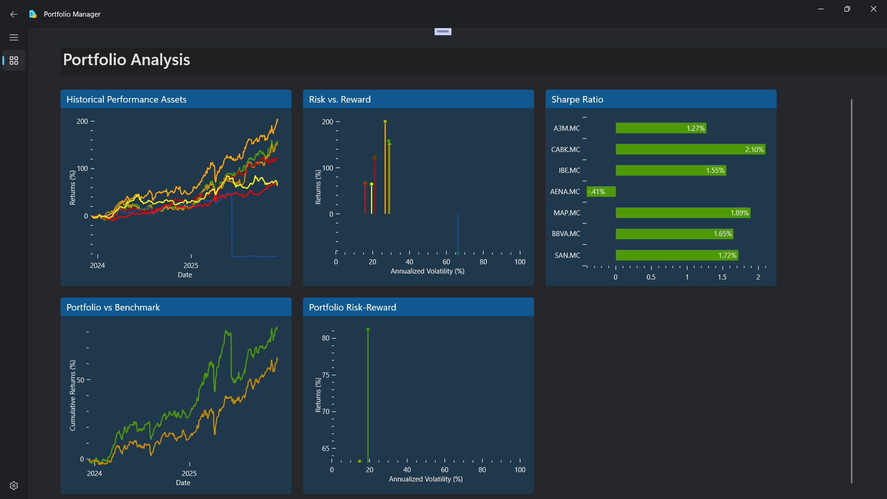
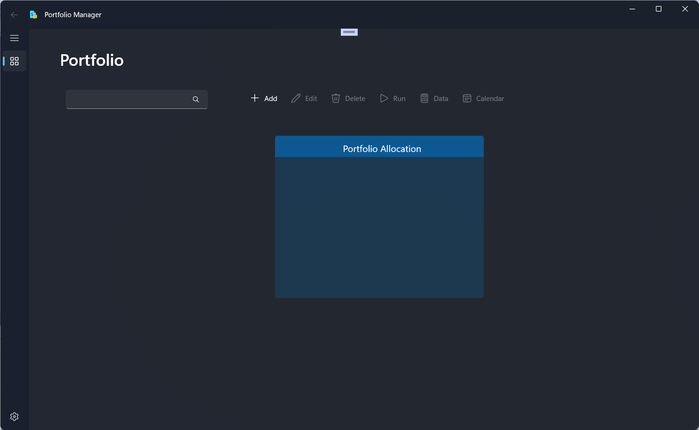
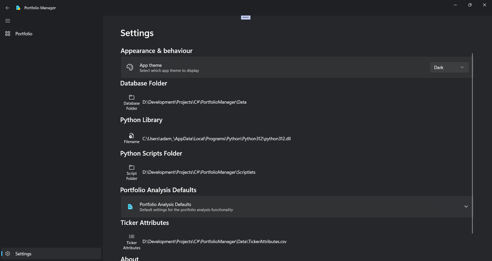
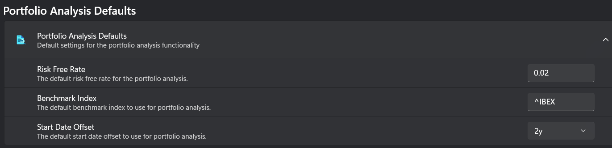
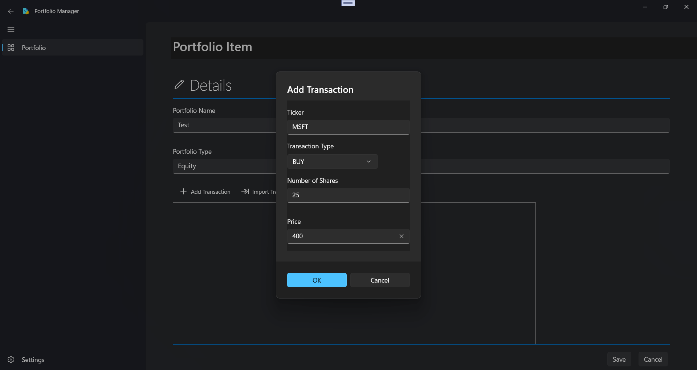
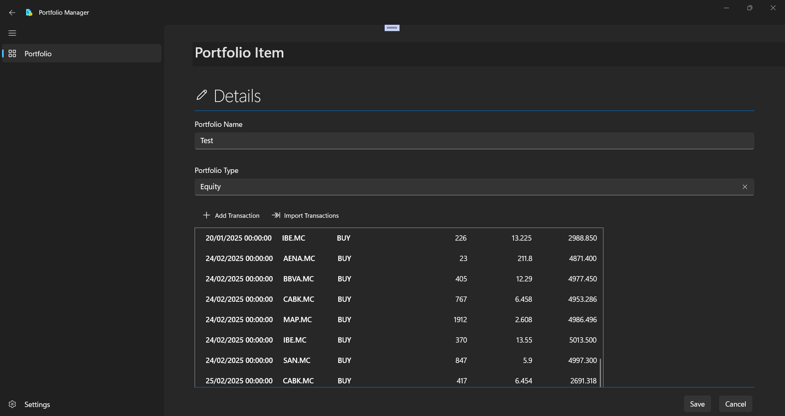
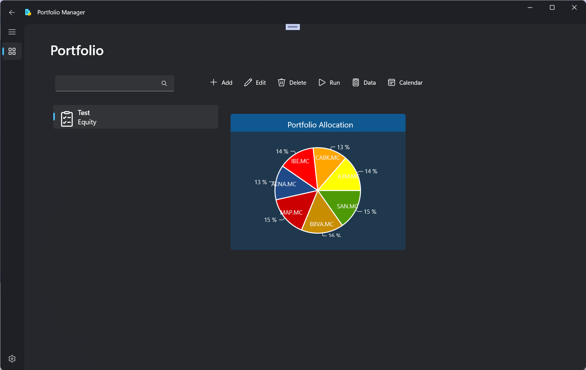
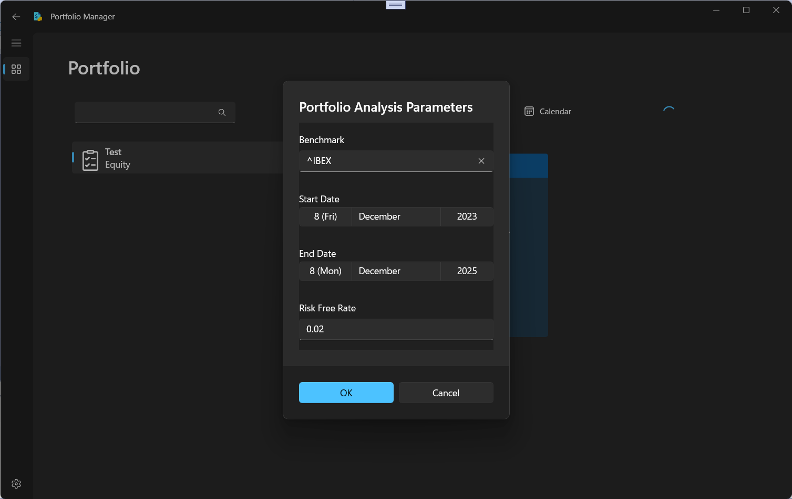
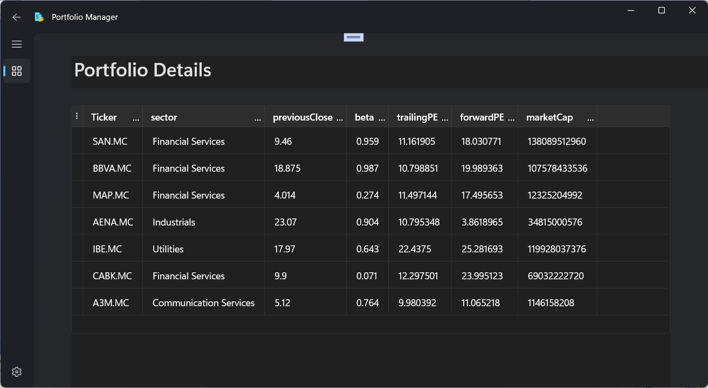
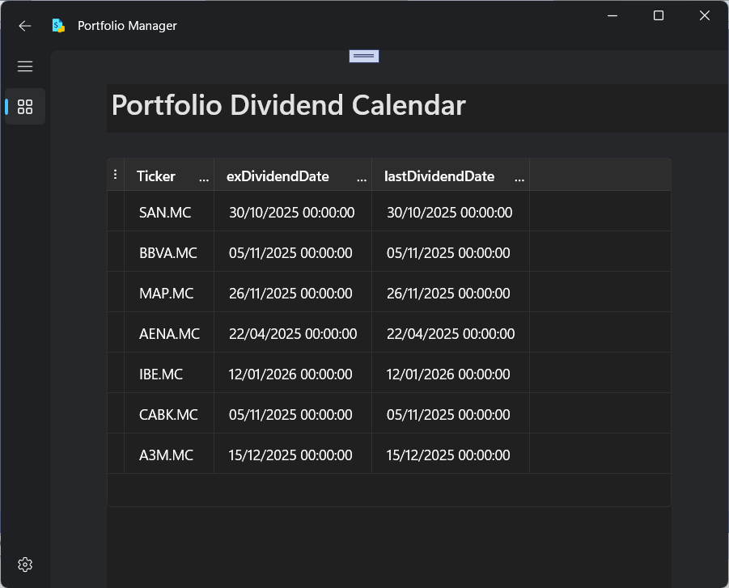

<a name="readme-top"></a>

<!-- PROJECT LOGO -->
<br />
<div align="center">
  <a href="https://github.com/Adam-Gladstone/PortfolioManager">
    
  </a>

  <h3 align="center">PortfolioManager (v1.0)</h3>

  <p align="center">
    <br />
    <a href="https://github.com/Adam-Gladstone/PortfolioManager"><strong>Explore the docs >></strong></a>
    <br />
    <br />
    <a href="https://github.com/Adam-Gladstone/PortfolioManager/issues">Report Bug</a>
    ·
    <a href="https://github.com/Adam-Gladstone/PortfolioManager/issues">Request Feature</a>
  </p>
</div>

<!-- TABLE OF CONTENTS -->
<details>
  <summary>Table of Contents</summary>
  <ol>
    <li>
      <a href="#about-the-project">About The Project</a>
      <ul>
        <li><a href="#built-with">Built With</a></li>
      </ul>
    </li>
    <li>
      <a href="#getting-started">Getting Started</a>
      <ul>
        <li><a href="#prerequisites">Prerequisites</a></li>
        <li><a href="#installation">Installation</a></li>
      </ul>
    </li>
    <li><a href="#usage">Usage</a></li>
    <li><a href="#roadmap">Roadmap</a></li>
    <li><a href="#license">License</a></li>
    <li><a href="#contact">Contact</a></li>
    <li><a href="#acknowledgments">Acknowledgments</a></li>
  </ol>
</details>

<!-- ABOUT THE PROJECT -->
## About The Project
__PortfolioManager__ is a Windows desktop application that allows you to define and analyse a portfolio of (equity) stocks. The analysis is centered on risk and return both within the portfolio and in comparison to a benchmark index.

The purpose of the project is to experiment with and demonstrate how to use Python from a C# client in the context of a relatively non-trivial application.

To do this, we use the Python.NET library (https://pythonnet.github.io/) in a C# (WinUI 3.0) application to execute Python scripts. 
There are currently two Python scripts:  [```portfolio_data.py```]() and [```portfolio_analysis.py```]().

The ```portfolio_data.py``` script retrieves ticker data. The ```portfolio_analysis.py``` script performs analyses of portfolio and benchmark returns.

The results are returned as Python objects and the interop layer takes the Python results (in terms of Python objects - dictionary, list, tuple etc - and Pandas Series and DataFrame's) and converts these to C# collections that can be used by OxyPlot (https://oxyplot.github.io/) to visualize the results in a series of graphs or as a table, depending on the function.

<a href="https://github.com/Adam-Gladstone/PortfolioManager">
  
</a>

Despite the name __PortfolioManager__, the main interest of the project is not financial portfolio analysis. The main interest is the arrangement of WinUI 3.0 for the UI (using the Community Toolkit and MVVM architecture), sitting on top of Python.NET, which in turn runs the portfolio analyses using  Python scripts.

__PortfolioManager__ is written in C# (.NET9.0) and uses WinUI and XAML for the user interface.

__PortfolioManager__ demonstrates:
- C#/WinUI and XAML for the UI
- Local file-based database using SQLite
- Community Toolkit features, specifically
    - settings page (with support for light/dark themes)
	- page navigation
	- dependency injection
	- flyout menus
	- a local sqlite database
	- MVVM architecture
- Python.NET - setup and execution of scripts
- OxyPlot graphing: pie chart, line graph, stem graph, bar chart
- Custom exception dialog
- Separate projects for the core (reusable functionality), testing, and user interface.
- (Unit testing using MSTest)

## References
Apart from using the Community Toolkit for WinUI 3.0, we made use of the following resources: 
* Graphing using OxyPlot is based on: https://xamlbrewer.wordpress.com/2022/02/28/drawing-charts-and-diagrams-with-oxyplot-in-winui-3/
* The PythonService uses Python.NET (https://pythonnet.github.io/) to evaluate Python scripts and retrieve data from 'yfinance'.
* The portfolio analysis scripts are based on: https://www.kaggle.com/code/lusfernandotorres/building-an-investment-portfolio-management-app/notebook

<p align="right">(<a href="#readme-top">back to top</a>)</p>

### Built With

* Visual Studio 2022
* C# (.NET9.0)

The following packages are used:
* CommunityToolkit.Mvvm Version="8.4.0"
* CommunityToolkit.WinUI.Controls.Segmented Version="8.2.250402"
* CommunityToolkit.WinUI.Controls.SettingsControls Version="8.2.250402"
* CommunityToolkit.WinUI.UI.Animations Version="8.2.250402"
* coverlet.collector Version="6.0.2"
* H.OxyPlot.WinUI Version="0.9.30"
* Dapper Version="2.1.66"
* Dapper.Contrib Version="2.0.78"
* Microsoft.Data.Sqlite Version="10.0.0"
* Microsoft.WindowsAppSDK Version="1.8.251106002"
* Microsoft.Xaml.Behaviors.WinUI.Managed Version="3.0.0"
* WinUI.TableView Version="1.3.4"
* Newtonsoft.Json Version="13.0.4"
* WinUIEx Version="2.9.0"


<p align="right">(<a href="#readme-top">back to top</a>)</p>

<!-- GETTING STARTED -->
## Getting Started
The project can be downloaded from the GitHub repository in the usual way.

The solution consists of four projects:
- PortfolioAnalysisApp: a command line application for testing basic communication with Python.NET
- PortfolioManager: the main WinUI 3.0/C# application
- PortfolioManager.Core: the core services: the database and the Python services
(- PortfolioManager.Tests.MSTest: a test project for unit testing the database service)

### Prerequisites

### Installation

<p align="right">(<a href="#readme-top">back to top</a>)</p>

<!-- USAGE EXAMPLES -->
## Usage
Build and start the application for the first time. You will be presented with an empty Portfolio screen. 

<a href="https://github.com/Adam-Gladstone/PortfolioManager">
  
</a>

Under the __Portfolio__ title is a toolbar with the main functions available. The left-hand side contains a list of current portfolios - empty at the moment - which can be searched and filtered using the search box. On the right hand side we have facilities to Add, Edit, and Delete portfolios. In addition we can Run analyses, retrieve additional data and get a dividend calendar. These are described in a bit more detail below.

Before jumping into setting up a portfolio it is important (critical) to setup the application. Go to the settings page:

<a href="https://github.com/Adam-Gladstone/PortfolioManager">
  
</a>

The Settings page gives you the option of configuring the following:
- App Theme - Dark/Light
- Database Folder - the location of the PortfolioData.db file
- Python Library - the location of the Python library (python312.dll)
- Python Scripts Folder - the location of the scripts folder
- Portfolio Analysis Defaults
- Ticker Attrbiutes - the location of the list of ticker attributes

So, set the path to the portfolio database. Then set the path to the Python library module (python312.dll) and the application scripts. Also you can choose the theme, or leave the default. Expand the Portfolio Analysis Defaults. 

<a href="https://github.com/Adam-Gladstone/PortfolioManager">
  
</a>

Enter the data (risk free rate, benchmark index and start date offset). The start date offset is used to determine the start date from which to request historic prices.

The Ticker Attributes contains a list of ticker attribute names supported by Yahoo Finance, and which can be requested. Of the 150 or so attributes, we specify only 6. This is the portfolio data returned from the Data menu.

With this completed, we can proceed to create a portfolio. Press the Add button and you will be taken to a Portfolio Details screen. Fill in the portfolio name and (optionally) a type (e.g. Equity). Transactions can be added manually using the 'Add Transaction' button. This brings up a window that can be completed with the transaction details.

<a href="https://github.com/Adam-Gladstone/PortfolioManager">
  
</a>

This works fine if you have a few transactions but soom becomes tedious. Instead, we can use the 'Import Transactions' function. This imports transactions from a.csv file. The transactions have the following fields:

```Date,Ticker,Buy/Sell,Amount,Price,Total```

This is similar to the structure used by Yahoo finance.

<a href="https://github.com/Adam-Gladstone/PortfolioManager">
  
</a>

After importing the transactions press the save button. This returns you to the main Portfolio page and the default Portfolio Allocation display.

<a href="https://github.com/Adam-Gladstone/PortfolioManager">
  
</a>

Double-clicking on the Portfolio will return you to the Portfolio Details editing page. The portfolio can be edited and deleted in the usual way. Further portfolios can be added using the 'Add' menu.

<p></p>

Now, with the Test portfolio selected, click the 'Run' button to perform the portfolio analysis.

The Portfolio Analysis Params dialog box is shown. 

<a href="https://github.com/Adam-Gladstone/PortfolioManager">
  
</a>

Accept the defaults or fill in the benchmark, start and end date for the analysis and risk free rate. Note that you cannot run the analysis without a benchmark or risk free rate. Also note that if the dates are set to non-working days, price data will not be available and an exception will be returned from __yfinance__.

Press OK. After some moments the Portfolio Details page is displayed with the results of the analysis.

<a href="https://github.com/Adam-Gladstone/PortfolioManager">
  
</a>


The analysis displays the following graphs:
- Historical Performance Assets: the historic returns of the assets over input the date range.
- Risk vs. Reward: the %ag return for the %age volatility.
- The Sharpe Ratio for each asset.
- The historical performance of the Portfolio vs. the Benchmark.
- The Portfolio Risk vs. Reward.

After performing the analysis, return to the main Portfolio page. Press the 'Data' button. This will retrieve the ticker data for each of the tickers in the portfolio. The attributes that are returned depend on the attributes that have been enabled in the TickerAttributes.csv file.

<a href="https://github.com/Adam-Gladstone/PortfolioManager">
  
</a>

Finally, return to the main Portfolio page and press the 'Calendar' button. The Portfolio Dividend Calendar is displayed for each of the tickers.

<a href="https://github.com/Adam-Gladstone/PortfolioManager">
  
</a>

<p align="right">(<a href="#readme-top">back to top</a>)</p>

<!-- ROADMAP -->
## Roadmap

Future directions:

See the [open issues](https://github.com/Adam-Gladstone/PortfolioManager/issues) for a full list of proposed features (and known issues).

<p align="right">(<a href="#readme-top">back to top</a>)</p>

<!-- LICENSE -->
## License

Distributed under the GPL-3.0 License. See `LICENSE.md` for more information.

<p align="right">(<a href="#readme-top">back to top</a>)</p>

<!-- CONTACT -->
## Contact

Adam Gladstone - (https://www.linkedin.com/in/adam-gladstone-b6458b156/)

Project Link: [https://github.com/Adam-Gladstone/PortfolioManager](https://github.com/Adam-Gladstone/PortfolioManager)

<p align="right">(<a href="#readme-top">back to top</a>)</p>

<!-- ACKNOWLEDGMENTS -->
## Acknowledgments

Helpful resources

* [Choose an Open Source License](https://choosealicense.com)
* [GitHub Pages](https://pages.github.com)
* [Font Awesome](https://fontawesome.com)
* [React Icons](https://react-icons.github.io/react-icons/search)

<p align="right">(<a href="#readme-top">back to top</a>)</p>

<!-- PROJECT SHIELDS -->

[![Issues][issues-shield]][issues-url]
[![GPL-3 License][license-shield]][license-url]
[![LinkedIn][linkedin-shield]][linkedin-url]

<!-- MARKDOWN LINKS & IMAGES -->
<!-- https://www.markdownguide.org/basic-syntax/#reference-style-links -->

[issues-shield]: https://img.shields.io/github/issues/Adam-Gladstone/PortfolioManager.svg?style=for-the-badge
[issues-url]: https://github.com/Adam-Gladstone/PortfolioManager/issues

[license-shield]: https://img.shields.io/github/license/Adam-Gladstone/PortfolioManager.svg?style=for-the-badge
[license-url]: https://github.com/Adam-Gladstone/PortfolioManager/LICENSE.md

[linkedin-shield]: https://img.shields.io/badge/-LinkedIn-black.svg?style=for-the-badge&logo=linkedin&colorB=555
[linkedin-url]: https://www.linkedin.com/in/adam-gladstone-b6458b156/
                      
<a name="readme-top"></a>
